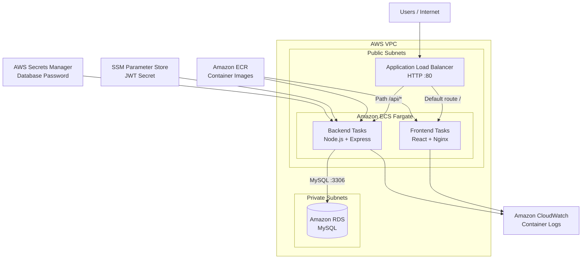
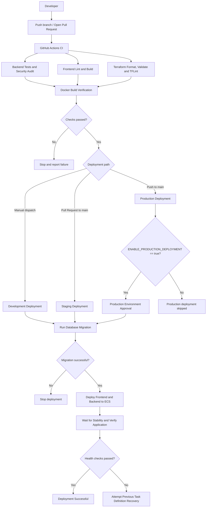

# MbeautyCakes – DevOps Capstone

A full-stack cake delivery application deployed on AWS using Terraform, Amazon ECS Fargate, Amazon ECR, Application Load Balancer, Amazon RDS and GitHub Actions CI/CD.

## Project Overview

MbeautyCakes allows customers to browse cakes, select cake weights, manage carts, place orders and track their orders. This capstone demonstrates infrastructure as code, containerization, automated testing, cloud deployment, monitoring and deployment recovery.

### Technology Stack

- Frontend: React, Vite, Nginx
- Backend: Node.js, Express.js, REST API
- Database: MySQL on Amazon RDS
- Containers: Docker and Amazon ECS Fargate
- Infrastructure as Code: Terraform
- Container Registry: Amazon ECR
- CI/CD: GitHub Actions
- Cloud Services: VPC, IAM, ALB, RDS, SSM Parameter Store, Secrets Manager and CloudWatch

## Architecture Diagram

The application runs in an AWS VPC in the Mumbai region (`ap-south-1`). The Application Load Balancer routes normal web requests to the frontend and `/api/*` requests to the backend. The RDS database is deployed in private subnets. ECS frontend and backend tasks use public subnets in the current Terraform configuration.



### Main Infrastructure Components

| Component | Purpose |
|---|---|
| Amazon VPC | Isolated AWS network with public and private subnets |
| Application Load Balancer | Routes frontend and API traffic |
| ECS Fargate | Runs frontend and backend containers |
| Amazon ECR | Stores frontend and backend Docker images |
| Amazon RDS MySQL | Stores application data in private subnets |
| IAM and OIDC | Grants GitHub Actions controlled AWS access |
| SSM Parameter Store | Stores the JWT secret |
| AWS Secrets Manager | Manages the RDS database password |
| CloudWatch | Stores container logs and monitoring data |
| S3 remote backend | Stores Terraform state remotely |
| Terraform state locking | Uses the configured S3 lockfile and DynamoDB table |

## CI/CD Pipeline Flow

GitHub Actions performs code quality checks, builds Docker images, pushes images to ECR and deploys the application to ECS.



### GitHub Actions Workflow Files

| Workflow | Trigger | Purpose |
|---|---|---|
| `ci.yml` | Push, Pull Request, Manual or Reusable | Tests, lint, Terraform checks and Docker build verification |
| `deploy.yml` | Manual dispatch | Development deployment |
| `deploy-staging.yml` | Pull Request to main or Manual dispatch | Staging deployment |
| `deploy-production.yml` | Push to main or Manual dispatch | Production deployment with approval protection |

### Deployment Process

1. Run backend tests, frontend lint/build and Terraform quality checks.
2. Build frontend and backend Docker images.
3. Push environment-specific images to Amazon ECR.
4. Capture the previous ECS task definition revisions.
5. Run the database migration as a standalone ECS task.
6. Deploy frontend and backend services to ECS Fargate.
7. Wait for ECS service stability and verify the homepage and cake API.
8. On a post-deployment failure, attempt to restore the previous task definitions.

## Setup Instructions

### Prerequisites

Install the following tools:

- Git
- Docker Desktop with Docker Compose
- Node.js and npm (for development and tests)
- Terraform 1.10 or newer
- AWS CLI
- An AWS account with the required permissions

### Clone the Repository

```powershell
git clone https://github.com/HiteshGupta03/infra-as-code-pipeline.git
cd infra-as-code-pipeline
```

### Run the Application Locally

Configure the application environment variables locally. Do not commit `.env` files, credentials or secrets.

```powershell
docker compose up -d --build
docker compose ps
```

Open the application at `http://localhost`. The API endpoint is `http://localhost/api/cakes`.

To inspect logs and stop the local application:

```powershell
docker compose logs
docker compose down
```

### Provision AWS Infrastructure with Terraform

The Terraform configuration is inside the `infrastructure` directory. The remote S3 backend and required state-locking resources must exist before initialization. Create account-specific environment variable files locally; these files are excluded from Git and must not contain committed secrets.

```powershell
cd infrastructure
terraform init
terraform workspace list
terraform workspace select dev
terraform plan -var-file=environments/dev.tfvars
```

Review the plan before applying infrastructure changes:

```powershell
terraform apply -var-file=environments/dev.tfvars
```

For staging, select the `staging` workspace and use `environments/staging.tfvars`. Review account restrictions and cost implications before provisioning production. Do not commit Terraform state files or secret variable files.

### Deploy Through GitHub Actions

- **Development:** Open Actions, select the development deployment workflow, use the `feature/terraform-bootstrap` branch and set the confirmation input to `yes`.
- **Staging:** Open a non-draft Pull Request targeting `main`. The staging workflow runs quality checks and deploys after they pass.
- **Production:** Deployment requires the repository variable `ENABLE_PRODUCTION_DEPLOYMENT` to equal `true`, followed by GitHub production Environment reviewer approval. Keep the variable unset until production IAM, ECS, ECR and the application URL are provisioned and verified.

## Deployment Runbook

The operational runbook contains the detailed procedures for infrastructure setup, application deployment, health verification, CloudWatch monitoring, database migrations, troubleshooting and rollback.

See: [Deployment Runbook](docs/deployment-runbook.md).

### Health Verification

The deployment workflow checks the application homepage and cake API. The backend health endpoint is `/health`. Example commands:

```powershell
curl.exe -f http://<ALB-DNS>/
curl.exe -f http://<ALB-DNS>/api/cakes
```

The cake API should return the seeded cake records. Review ECS service events and CloudWatch logs when a task or health check fails.

### Rollback

The deployment workflow captures the previous frontend and backend task definition ARNs. On a post-deployment failure, it attempts to restore those task definitions and waits for service stability. ECS deployment circuit breakers with rollback are also enabled.

The rollback recovery time has not yet been measured against the project 60-second target.

## Monthly AWS Cost Estimate

The estimated staging baseline is approximately **US$110 per month**, assuming 730 operating hours, four minimum Fargate tasks (two frontend and two backend), one Application Load Balancer, six public IPv4 addresses and one Single-AZ `db.t3.micro` RDS MySQL instance with 20 GB gp3 storage.

This is an approximate planning estimate, not an AWS quote. Actual charges vary with traffic, LCU usage, log ingestion, data transfer, backups, taxes and current AWS pricing. Development resources are not included. Scaling ECS tasks above the minimum increases costs.

See the detailed assumptions and calculation: [AWS Monthly Cost Estimate](docs/aws-cost-estimate.md).

## Current Implementation Status

| Requirement | Status |
|---|---|
| Terraform VPC and subnet modules | Implemented |
| ECS Fargate and Application Load Balancer | Implemented |
| ECR repositories | Implemented |
| IAM roles, security groups and GitHub OIDC | Implemented |
| S3 remote Terraform state and locking | Implemented |
| RDS MySQL and application secrets | Implemented |
| CloudWatch log groups | Implemented |
| Development deployment | Deployed and tested |
| Staging deployment | Deployed and tested |
| Production deployment guard and approval gate | Configured; deployment disabled pending production infrastructure |
| Automated deployment recovery | Implemented; recovery time not yet measured |

## Security Practices

- GitHub Actions uses OIDC for AWS authentication instead of long-lived AWS access keys.
- JWT secrets are stored in AWS Systems Manager Parameter Store.
- The RDS master password is managed through AWS Secrets Manager.
- IAM permissions are scoped to the required deployment resources.
- The RDS database is not publicly accessible.
- Terraform state and account-specific variable files are not committed.
- Production deployment is protected by GitHub Environment approval.

## Project Documentation

- [Architecture](docs/architecture.md)
- [CI/CD Pipeline](docs/cicd-pipeline.md)
- [Deployment Runbook](docs/deployment-runbook.md)
- [AWS Cost Estimate](docs/aws-cost-estimate.md)
- [Deployment Evidence](docs/evidence/)

## Author

**Hitesh Gupta**

GitHub: [HiteshGupta03](https://github.com/HiteshGupta03)
Capstone Repository: [infra-as-code-pipeline](https://github.com/HiteshGupta03/infra-as-code-pipeline)
