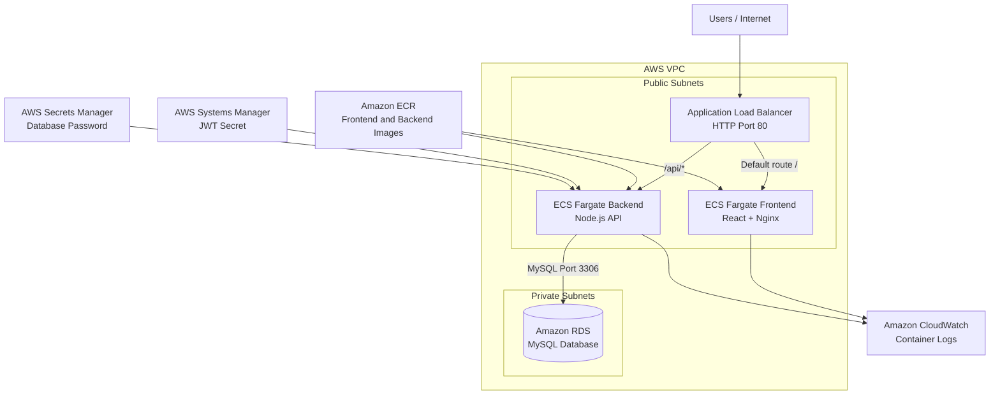

# AWS Architecture – MbeautyCakes

## 1. Overview

MbeautyCakes is a containerized web application deployed on AWS using Terraform and Amazon ECS Fargate.

The architecture uses separate development and staging environments. Production deployment configuration and approval protection are prepared, but production infrastructure has not yet been provisioned.

## 2. Architecture Diagram

