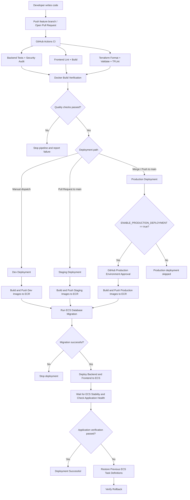

# CI/CD Pipeline Flow

## 1. Overview

GitHub Actions automates code quality checks, Docker image builds and deployments to AWS ECS Fargate.

## 2. Pipeline Diagram

## 3. Workflow Files

| Workflow | Trigger | Purpose |
|---|---|---|
| `.github/workflows/ci.yml` | Push, Pull Request, Manual, Reusable | Tests, lint, Terraform checks and Docker builds |
| `.github/workflows/deploy.yml` | Manual dispatch | Deploy to development |
| `.github/workflows/deploy-staging.yml` | Pull Request to main, Manual dispatch | Deploy to staging |
| `.github/workflows/deploy-production.yml` | Push to main, Manual dispatch | Production deployment with required approval |

## 4. Deployment Sequence

1. Run code quality and security checks.
2. Build frontend and backend Docker images.
3. Push environment-specific images to Amazon ECR.
4. Capture previous ECS task definitions.
5. Run database migrations as a standalone ECS task.
6. Continue deployment only when migration exits successfully.
7. Deploy backend and frontend to ECS Fargate.
8. Wait for ECS service stability and verify the homepage and cake API.
9. On post-deployment failure, attempt restoration of previous ECS task definitions.

## 5. Security and Approval

- GitHub Actions authenticates to AWS using OIDC.
- Separate IAM deployment roles are configured for dev, staging and production.
- JWT and database passwords are retrieved through AWS secret services.
- Production uses the GitHub `production` Environment with required reviewer approval.`r`n- The deployment job also requires repository variable `ENABLE_PRODUCTION_DEPLOYMENT` to equal `true`. Keep it unset until production resources are ready.

## 6. Current Implementation Status

- Development deployment: Implemented and tested.
- Staging deployment: Implemented and successfully tested.
- Production workflow guard and approval protection: Configured; deployment disabled until production infrastructure is provisioned.
- Rollback workflow: Implemented; rollback recovery time has not yet been measured.
